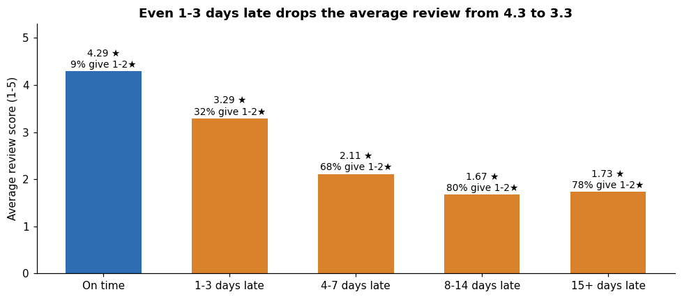
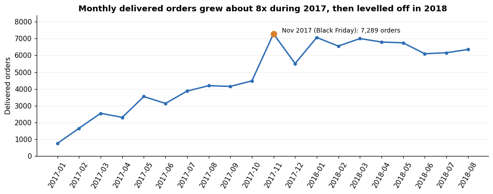
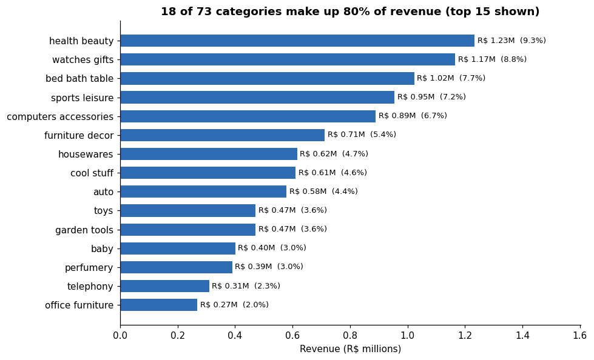
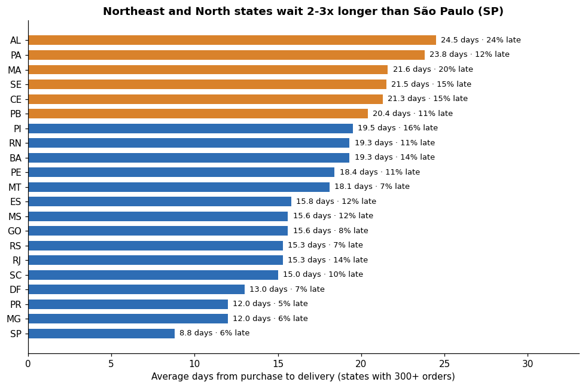
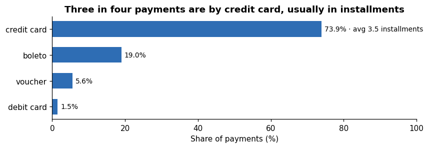

# Olist E-commerce Analysis: Revenue, Delivery Performance and Customer Retention

An end-to-end data analysis of **96,478 delivered orders** from Olist, a Brazilian online marketplace, using **SQL (SQLite)**, **Python (pandas)** and **matplotlib**. The project answers six business questions and ends with recommendations.

**Headline finding:** late delivery is the biggest driver of bad reviews. On-time orders average **4.29★**, but orders 4–7 days late average **2.11★**, and 68% of those customers give 1–2 stars.



## Business questions and answers

| # | Question | Answer |
|---|---|---|
| 1 | How did orders grow over time? | From 750 orders/month (Jan 2017) to 6,000–7,000/month in 2018; Black Friday (Nov 2017) was the peak at 7,289 orders, +63% over October |
| 2 | Which categories drive revenue? | 18 of 73 categories bring 80% of revenue; health & beauty leads with 9.3% |
| 3 | Where is delivery slowest? | São Paulo averages 8.8 days; Alagoas (AL) 24.5 days with 24% of orders late |
| 4 | Does late delivery hurt reviews? | Yes: 1–3 days late drops the average from 4.29★ to 3.29★ |
| 5 | Do customers come back? | 97% of 93,358 customers ordered only once |
| 6 | How do customers pay? | Credit card 74% (avg 3.5 installments), boleto 19% |

## Charts

| Monthly orders | Revenue by category |
|---|---|
|  |  |
| **Delivery time by state** | **Payment methods** |
|  |  |

## Recommendations

1. **Set realistic delivery dates by region** and notify customers early when an order is running late.
2. **Review carriers for Rio de Janeiro and the Northeast**; RJ is late 13.5% of the time despite being close to São Paulo.
3. **Start a retention programme**: a second-order coupon after an on-time, well-reviewed delivery.
4. **Plan Black Friday capacity from September.**
5. **Feature the top categories and the installment price** in marketing.

## Tools and skills used

- **SQL:** joins across 7 tables, CTEs, aggregations, `CASE` bucketing, window functions (`SUM() OVER`, `RANK()`), date arithmetic with `julianday`
- **Python:** pandas for data loading and quality checks, matplotlib for charts
- **Analysis:** data cleaning, Pareto (80/20) analysis, cohort-style repeat-purchase analysis, turning findings into recommendations

## Project structure

```
olist-ecommerce-analysis/
├── data/raw/                  put the 8 Olist CSV files here (download link below)
├── sql/analysis_queries.sql   one named SQL query per business question
├── src/build_db.py            loads the CSVs into data/olist.db (SQLite)
├── notebooks/olist_analysis.ipynb   full analysis with charts and insights
├── images/                    charts used in this README
└── requirements.txt
```

## How to run

1. Download the dataset from [Kaggle: Brazilian E-Commerce Public Dataset by Olist](https://www.kaggle.com/datasets/olistbr/brazilian-ecommerce) and unzip it.
2. Copy these 8 CSV files into `data/raw/` (the geolocation file is not needed): `olist_orders_dataset.csv`, `olist_order_items_dataset.csv`, `olist_customers_dataset.csv`, `olist_products_dataset.csv`, `olist_order_payments_dataset.csv`, `olist_order_reviews_dataset.csv`, `olist_sellers_dataset.csv`, `product_category_name_translation.csv`
3. Run:

```bash
pip install -r requirements.txt
python src/build_db.py                 # creates data/olist.db
jupyter notebook notebooks/olist_analysis.ipynb
```

The raw data is not stored in this repository because of its size. The notebook is saved with all outputs, so the results and charts can be viewed on GitHub without running it.

## Data

[Brazilian E-Commerce Public Dataset by Olist](https://www.kaggle.com/datasets/olistbr/brazilian-ecommerce) (Kaggle, CC BY-NC-SA 4.0): about 100,000 anonymised orders placed from 2016 to 2018. Revenue in this project means product price excluding freight, on delivered orders, in Brazilian reais (R$).

## Limitations

- One marketplace in one country (Brazil) from 2016 to 2018.
- The link between late delivery and reviews is a correlation; measuring the exact effect would need a controlled test.

---

**Author:** Vishnu Vardhan Reddy M R · B.E. CSE (Data Science), Acharya Institute of Technology, Bangalore
